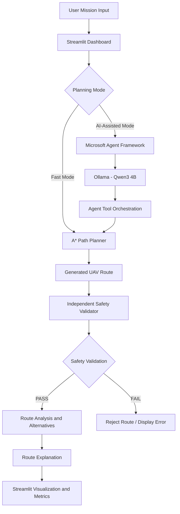

# 🚁 UAV Path Planning Using Agentic AI

### An Agentic AI-Based Hybrid Framework for Intelligent UAV Route Planning and Safety Validation


---

## 📌 Project Overview

**UAV Path Planning Using Agentic AI** is a hybrid intelligent path-planning system designed to determine safe and feasible routes for Unmanned Aerial Vehicles (UAVs) in a two-dimensional grid environment.

The project integrates **Agentic AI, deterministic search algorithms, and independent safety validation** to demonstrate how AI agents can coordinate specialized computational tools to solve path-planning problems.

Instead of relying entirely on a Large Language Model (LLM) to calculate a route, the system uses the **A* (A-Star) algorithm** for deterministic pathfinding and a separate Python-based safety validator to verify the generated route.

The Microsoft Agent Framework, powered by a locally running Qwen3 4B model through Ollama, provides an optional AI-assisted layer for mission interpretation, tool orchestration, and route explanation.

The application provides an interactive Streamlit dashboard where users can configure UAV missions, visualize obstacles, generate routes, validate safety, and compare alternative paths.

## 🎯 Project Objectives

- Develop an intelligent UAV path-planning framework using Agentic AI.
- Integrate Microsoft Agent Framework with a locally hosted LLM.
- Implement deterministic A* search for reliable route generation.
- Develop an independent safety-validation mechanism.
- Compare alternative routes based on distance and direction changes.
- Provide an interactive 2D visualization through Streamlit.
- Demonstrate the advantages of combining AI-based orchestration with deterministic algorithms.

## 🏗️ System Architecture

The proposed system follows a hybrid architecture consisting of deterministic planning components and an optional AI-assisted agent layer.



### Core Components

| Component | Responsibility |
|---|---|
| Streamlit Dashboard | Mission configuration and route visualization |
| Microsoft Agent Framework | AI agent creation and tool orchestration |
| Ollama | Local LLM execution |
| Qwen3 4B | Mission interpretation and AI-assisted reasoning |
| A* Algorithm | Deterministic shortest-path search |
| Safety Validator | Independent route verification |
| Alternative Route Analyzer | Exploration and comparison of candidate routes |
| Route Explanation | Explains route choices using computed evidence |

## ⚙️ Key Features

### 1. Hybrid Path Planning

The application supports two planning modes:

**Fast Mode**
- Uses the A* algorithm directly.
- Performs independent safety validation.
- Avoids unnecessary LLM processing.
- Provides faster and deterministic route planning.

**AI-Assisted Mode**
- Uses Microsoft Agent Framework with Ollama and Qwen3 4B.
- Allows the agent to coordinate specialized planning and validation tools.
- Uses A* for actual route computation.
- Provides an AI-generated explanation based on available route-analysis results.

Both modes use the same underlying path-planning and safety-validation logic.

### 2. A* Pathfinding Algorithm

A* is a heuristic-based search algorithm used to find a shortest path between a starting point and a destination.

The algorithm evaluates each node using:

\[
f(n)=g(n)+h(n)
\]

Where:

- \(g(n)\): Actual cost from the starting node to the current node.
- \(h(n)\): Estimated cost from the current node to the destination.
- \(f(n)\): Estimated total cost of the path through the current node.

For four-directional movement with equal movement costs, the Manhattan distance heuristic is used:

\[
h(n)=|x_1-x_2|+|y_1-y_2|
\]

The algorithm considers horizontal and vertical movements while avoiding blocked grid cells.

### 3. Independent Safety Validation

A generated route is not automatically considered safe simply because the planning algorithm or AI agent returns it.

The independent Python safety validator checks:

- Whether a valid route exists.
- Whether the route starts at the requested starting position.
- Whether the route reaches the requested destination.
- Whether all coordinates remain within grid boundaries.
- Whether the route avoids all specified obstacles.
- Whether consecutive waypoints follow valid four-directional movement.

A route is displayed as validated only when the independent validator returns a successful result.

### 4. Alternative Route Analysis

The system can analyze multiple candidate routes and compare their properties.

The analysis includes:

- Total number of moves.
- Number of waypoints.
- Horizontal and vertical movements.
- Direction changes.
- Comparison of candidate route lengths.

The explanation is based on computed route information rather than unsupported claims made by the LLM.

**Note:** Alternative-route exploration is limited to the candidates found by the implemented search procedure. It does not establish that every possible route has been examined.

### 5. Interactive Streamlit Dashboard

The dashboard allows users to:

- Configure the grid size.
- Select starting and destination coordinates.
- Add and remove obstacles.
- Preview the environment immediately when inputs change.
- Select Fast Mode or AI-Assisted Mode.
- Generate a route using the Plan Route button.
- View the planned route and validation status.
- Examine route metrics and alternative-route explanations.

Route planning is triggered explicitly by the user rather than automatically whenever an input changes.

## 🛠️ Technology Stack

| Technology | Purpose |
|---|---|
| Python 3.11 | Core programming language |
| Streamlit | Interactive web application |
| Microsoft Agent Framework | Agent development and tool orchestration |
| Ollama | Local LLM runtime |
| Qwen3 4B | AI-assisted mission reasoning |
| A* Search | Deterministic pathfinding |
| NumPy | Numerical and grid-related operations, if used |
| Matplotlib | Visualization, if used in the implementation |

## 📂 Project Structure

```text
uav_agentic_path_planning_2d/
│
├── app.py
│   └── Streamlit dashboard and application interface
│
├── path_planner.py
│   └── A* pathfinding implementation
│
├── safety_validator.py
│   └── Independent route safety validation
│
├── planning_agent.py
│   └── Microsoft Agent Framework and Ollama integration
│
├── route_explainer.py
│   └── Alternative route analysis and route explanation
│
├── requirements.txt
│   └── Python dependencies
│
├── README.md
│   └── Project documentation
│
└── .gitignore
    └── Files excluded from version control
```

*The structure above describes the main project modules. Include only files that are actually present in your repository.*

## 💻 Installation and Setup

Follow these steps to run the project locally.

### Prerequisites

Make sure the following are installed:

- Python 3.11
- Git
- Visual Studio Code (recommended)
- Ollama (required for AI-Assisted Mode)

### Step 1: Clone the Repository

```bash
git clone <YOUR_GITHUB_REPOSITORY_URL>
```

Navigate to the project directory:

```bash
cd uav_agentic_path_planning_2d
```

### Step 2: Create a Virtual Environment

```bash
python -m venv .venv
```

Activate the environment.

**Windows PowerShell:**

```powershell
.\.venv\Scripts\Activate.ps1
```

**Windows Command Prompt:**

```cmd
.venv\Scripts\activate.bat
```

### Step 3: Install Dependencies

```bash
pip install -r requirements.txt
```

### Step 4: Install and Configure Ollama

Download and install Ollama:

https://ollama.com/download

Pull the Qwen3 4B model:

```bash
ollama pull qwen3:4b
```

Verify that the model is available:

```bash
ollama list
```

Test the model:

```bash
ollama run qwen3:4b
```

Make sure the Ollama service is running before using AI-Assisted Mode.

### Step 5: Run the Application

From the project directory, execute:

```bash
python -m streamlit run app.py
```

The Streamlit application will open in your browser, usually at:

```text
http://localhost:8501
```

**Important:** Fast Mode does not require LLM inference. AI-Assisted Mode requires Ollama to be running with the Qwen3 4B model available.

## 🚀 How to Use the Application

1. Launch the Streamlit application.
2. Configure the grid environment.
3. Select the UAV starting position.
4. Select the destination.
5. Add obstacles to the environment.
6. Choose the planning mode.
7. Click **Plan Route**.
8. View the generated route.
9. Check the independent safety-validation result.
10. Explore alternative routes and the route explanation, where available.

## 🧪 Example Mission

Consider the following test environment:

| Parameter | Value |
|---|---|
| Grid Size | 10 × 10 |
| Starting Position | (0, 0) |
| Destination | (9, 7) |
| Obstacles | (2, 0), (2, 1), (2, 2) |
| Movement | Four-directional |
| Movement Cost | 1 per cell |

### Example Route

```text
(0,0) → (0,1) → (0,2) → (0,3)
      → (0,4) → (0,5) → (0,6)
      → (0,7) → (1,7) → (2,7)
      → (3,7) → (4,7) → (5,7)
      → (6,7) → (7,7) → (8,7)
      → (9,7)
```

### Example Results

| Metric | Result |
|---|---:|
| Grid Size | 10 × 10 |
| Total Waypoints | 17 |
| Total Moves | 16 |
| Horizontal Moves | 9 |
| Vertical Moves | 7 |
| Direction Changes | 1 |
| Obstacle Collisions | 0 |
| Manhattan Lower Bound | 16 |
| Safety Validation | PASS |

The route contains 16 moves, which equals the Manhattan-distance lower bound between the start and destination. Therefore, it is a shortest route under the assumptions of four-directional movement and equal movement costs. Other shortest routes may also exist.

*The values above describe the example mission and are not guaranteed results for every input.*

## 🔐 Safety and Reliability

Safety validation is performed independently of the LLM.

The system follows these principles:

- The LLM does not directly determine whether a route is safe.
- A* performs the actual route search.
- The independent validator checks the generated route.
- Invalid routes are not treated as successfully validated routes.
- Route explanations are based on available computational evidence.

This separation helps reduce dependence on LLM-generated claims for safety-critical checks.

## ⚠️ Current Scope and Limitations

This project is currently a **2D grid-based UAV path-planning prototype** developed for academic and experimental purposes.

The current implementation has the following limitations:

- Operates in a static 2D grid environment.
- Uses discrete horizontal and vertical movements.
- Does not currently integrate real UAV hardware or flight controllers.
- Does not use live GPS, LiDAR, camera, or other onboard sensor data.
- Does not implement real-world 3D flight dynamics.
- Does not account for wind, weather, or changing obstacles.
- Does not represent a validated physical energy-consumption model.
- Alternative-route analysis is limited by the implemented candidate-search procedure.
- AI-assisted planning depends on local Ollama availability and LLM response time.

**Safety Disclaimer:** This is an academic prototype and has not been validated for real-world UAV navigation or autonomous flight. It must not be used as a flight-control or operational safety system.

## 🔮 Future Scope

Potential extensions include:

- 3D UAV path planning.
- Dynamic obstacle detection and avoidance.
- Integration with GPS and real-time sensor data.
- Energy-aware and battery-constrained path optimization.
- Multi-objective optimization considering distance, time, energy, and safety.
- Multi-UAV coordination and collision avoidance.
- Integration with simulation environments such as AirSim or Gazebo.
- Real-time replanning when environmental conditions change.
- Advanced explainability and agent-based decision analysis.

## 👨‍💻 Author

**Sushil Kumar**  
M.Tech – Operations Research and Data Analytics  
Indian Institute of Technology Kharagpur

- GitHub: [su1sh2il](https://github.com/su1sh2il)

---

⭐ **If you find this project interesting, consider giving the repository a star!**
